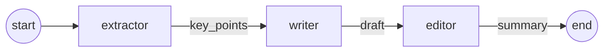

# Pattern 01: Sequential Pipeline

A fixed chain of specialized agents where each agent's output becomes the next agent's input. There is no routing and no loops: the order of execution is decided in code, not by the model.



## Use case

Summarize a technical article into one paragraph for a senior engineering audience, split into three steps:

| Agent | Input | Output | Responsibility |
|-------|-------|--------|----------------|
| `extractor` | `article` | `key_points` | Pull 4–7 concrete, fact-bearing points from the article |
| `writer` | `key_points` | `draft` | Turn the points into a connected paragraph (≤120 words) |
| `editor` | `draft` | `summary` | Tighten wording without changing any facts |

Each agent only sees the previous step's output, wrapped in XML tags (`<article>`, `<key_points>`, `<draft>`). Its system prompt says where it sits in the pipeline and who consumes its output.

## State

All agents share a single `PipelineState` (`state.py`):

```python
class PipelineState(TypedDict, total=False):
    article: str
    key_points: str
    draft: str
    summary: str
    usage: Annotated[list[LLMUsage], operator.add]
```

- `total=False` because the graph starts with only `article`; each node fills in its own field.
- `usage` uses an `operator.add` reducer, so every node appends its token and latency record instead of overwriting the list.

## Files

| File | Contents |
|------|----------|
| `state.py` | `PipelineState` definition |
| `agents.py` | System prompts and the three node functions |
| `graph.py` | LangGraph wiring, `run_pipeline()` entry point |

## Running

Requires `ANTHROPIC_API_KEY` and `WORKER_MODEL` in `.env` (see `.env.example`).

```bash
uv run python -m patterns.p01_pipeline.graph
```

This prints the final summary, the per-agent usage records, and the graph as Mermaid.

## When to use it

**Good fit**
- The task breaks down into stable, ordered steps.
- Each step benefits from a narrow, focused prompt.
- You want predictable cost and latency (exactly N model calls).

**Trade-offs**
- Latency adds up: steps run strictly one after another.
- Errors propagate. If the extractor misses a point, later agents cannot recover it.
- No feedback loop: the editor cannot send work back to the writer.

Later patterns in this repo address these limits with routing, parallelism, and review loops.
