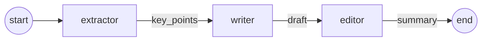

# Pattern 01: Sequential Pipeline

A fixed chain of specialized agents where each agent's output becomes the next agent's input. There is no routing and no loops: the order of execution is decided in code, not by the model.



**TL;DR.** On a 16-article benchmark, the three-agent pipeline used about **2.4x the tokens and latency** of a single well-prompted call, and it did **not** produce better summaries: the baseline scored higher on fidelity, coverage and concision. The likely cause is architectural: each handoff between agents loses information that later agents cannot recover.

## Use case

Summarize a technical article into one paragraph for a senior engineering audience, split into three steps:

| Agent | Input | Output | Responsibility |
|-------|-------|--------|----------------|
| `extractor` | `article` | `key_points` | Pull 4–7 concrete, fact-bearing points from the article |
| `writer` | `key_points` | `draft` | Turn the points into a connected paragraph (≤120 words) |
| `editor` | `draft` | `summary` | Tighten wording without changing any facts |

Each agent only sees the previous step's output, wrapped in XML tags (`<article>`, `<key_points>`, `<draft>`). Its system prompt says where it sits in the pipeline and who consumes its output.

## State

All agents share a single `PipelineState` (`state.py`):

```python
class PipelineState(TypedDict, total=False):
    article: str
    key_points: str
    draft: str
    summary: str
    usage: Annotated[list[LLMUsage], operator.add]
```

- `total=False` because the graph starts with only `article`; each node fills in its own field.
- `usage` uses an `operator.add` reducer, so every node appends its token and latency record instead of overwriting the list.
- Fields are named after their **content** (`key_points`, `draft`), not the agent that produces them, so agents can be removed or swapped without renaming state.

## Files

| File | Contents |
|------|----------|
| `state.py` | `PipelineState` definition |
| `agents.py` | System prompts and the three node functions |
| `graph.py` | LangGraph wiring, `run_pipeline()` entry point |
| `baseline.py` | Single-call baseline used for comparison |
| `judge.py` | LLM-as-judge rubric and `judge_summary()` |
| `run.py` | Evaluation entry point: runs both systems, judges them, prints the summary table |
| `data/articles.jsonl` | Evaluation dataset (16 cases) |
| `results/` | Raw results of the evaluation reported below |

## Running

Requires `ANTHROPIC_API_KEY`, `WORKER_MODEL` and `JUDGE_MODEL` in `.env` (see `.env.example`).

```bash
# Run one system on one case (defaults to the first case in the dataset)
uv run python -m patterns.p01_pipeline.graph medium-runtime-benchmark-contradictory
uv run python -m patterns.p01_pipeline.baseline medium-runtime-benchmark-contradictory

# Judge both systems on one case
uv run python -m patterns.p01_pipeline.judge real-discord-read-states

# Full evaluation (16 cases x 3 runs x 2 systems = 96 executions)
uv run python -m patterns.p01_pipeline.run

# Quick smoke test
uv run python -m patterns.p01_pipeline.run --limit 2 --runs 1

# Recompute the table from saved results, without calling any model
uv run python -m patterns.p01_pipeline.run --from-file patterns/p01_pipeline/results/p01_pipeline_20261015_171243.jsonl
```

## Evaluation

### Starting hypothesis

An early single-run comparison on a short REST → gRPC article suggested that the pipeline might be **more faithful** than the baseline: the baseline added an unsupported adjective ("substantial performance gains"), while the pipeline stuck to the facts. The hypothesis was that isolating the steps (the writer never sees the article, the editor cannot add content) improves faithfulness, at about 3x the cost. The full evaluation below was designed to test that claim. **It did not hold.**

### Setup

| | |
|---|---|
| Systems | `pipeline` (3 calls: extractor → writer → editor) vs. `baseline` (1 call with the same combined instructions) |
| Worker model | `claude-haiku-5-5`, used by every agent in both systems |
| Judge model | `claude-sonnet-5-5`, a stronger model than the workers to reduce self-preference bias |
| Dataset | 16 technical articles (3 short, 10 medium, 3 long), including 3 deliberately hard cases |
| Runs | 3 per case and system, 96 executions in total |
| Rubric | Fidelity, coverage, clarity, concision, each scored 1–5, with the judge's reasoning written before the scores |

**Dataset.** Four articles are original paraphrases of public incident reports and engineering posts (Discord's Go → Rust migration, Cloudflare's July 2019 outage, GitHub's October 2018 incident, AWS S3's February 2017 outage); the rest were written for this benchmark. The hard cases are a marketing text with no concrete facts, a benchmark report that contradicts itself (35% vs. 22% improvement, three vs. five nodes), and a cost-reduction story padded with irrelevant anecdotes. Each case carries `length` and `tags` metadata, and each real-event case links its source.

**Methodology choices.**

- **Same interface for both systems.** `run_pipeline` and `run_baseline` share the same signature, so the shared harness (`core/harness.py`) treats them identically.
- **Multiple runs per case.** The worker model does not accept a `temperature` parameter, so outputs vary between runs. Three runs per case let the evaluation average out that variability.
- **Systems alternate within each case** (case → run → system), so changing API conditions affect both equally.
- **End-to-end latency**, measured around the whole system call. The judge runs after the timer stops.
- **Tokens instead of dollars.** Prices change over time; token counts do not, and they can be converted with current prices.
- **Failures are recorded**, not hidden. System errors and judge errors are tracked separately.
- **Structured judge output** via Pydantic and `with_structured_output(method="json_schema")`, so scores are typed and validated.

### Results

| System | Fidelity | Coverage | Clarity | Concision | Avg score | Score std | Calls | Input tokens | Output tokens | Latency | Errors |
|--------|---------:|---------:|--------:|----------:|----------:|----------:|------:|-------------:|--------------:|--------:|-------:|
| pipeline | 4.35 | 3.85 | **4.62** | 3.23 | 4.02 | 0.59 | 3 | 1,943 | 1,358 | 6.91 s | 0/48 |
| baseline | **4.58** | **4.12** | 4.40 | **3.62** | **4.18** | 0.50 | 1 | 800 | 554 | 2.93 s | 0/48 |

Scores and resources are means per run. `Score std` is the standard deviation of the per-run average score. Raw results: [`results/p01_pipeline_20261015_171243.jsonl`](results/p01_pipeline_20261015_171243.jsonl).

### Findings

**1. The pipeline is about 2.4x more expensive and not better.** It used 2.4x the input tokens, 2.5x the output tokens and 2.4x the latency. The baseline scored higher on three of four criteria; the pipeline only won on clarity, plausibly thanks to the dedicated editor. Even if quality had tied, the pipeline would not justify its cost for this task.

**2. Handoffs lose information, and later agents cannot recover it.** The two criteria where the pipeline lost most clearly, fidelity and coverage, point to the same mechanism:

- *Coverage* is capped by the extractor. The writer only sees 4–7 bullet points; anything the extractor leaves out is gone.
- *Fidelity* suffers because bullet points compress **modality**: hedges, attributions and intentions. Concrete examples from the runs:
  - In the Discord case, the article says the Rust port *was meant to* fix latency and validate Rust. The pipeline wrote that it *fixed* the latency and *validated* Rust, turning an intention into a result. The judge scored that run 3/5 on fidelity, versus 5/5 for the baseline.
  - In the contradictory benchmark case, one pipeline run turned "reduced Bun's advantage **slightly**" into "narrowed Bun's advantage **further**", and "the team recommends postponing" into an unattributed "migration should be postponed".

The writer has no way to know that "port fixes latency" was an intention, because it never sees the article. Isolation, the property expected to protect faithfulness, is what hurts it.

**3. Run-to-run variability is large enough to flip single comparisons.** On the contradictory benchmark case, the same prompts produced opposite conclusions in two consecutive runs: first the baseline flagged the 35% vs. 22% discrepancy neutrally while the pipeline claimed the 22% figure "corrects" the 35%, and in the next run the roles reversed. Neither system flagged the second contradiction (three vs. five nodes) in any run inspected. This is why the starting hypothesis, based on one run of one article, was misleading, and why the evaluation uses multiple runs.

**4. Neither system reliably respects the 120-word limit.** Both regularly exceeded it, and the pipeline did so more often despite having an agent whose only job is tightening. Concision was the lowest-scoring criterion for both systems.

### How confident are these results?

The average-score gap (0.16) is smaller than the per-run standard deviation (~0.5–0.6), but that standard deviation describes individual runs, not the mean of 48 runs. The standard error of each mean would be roughly 0.07–0.09 if runs were independent. They are not fully independent (48 runs come from 16 cases), so the real uncertainty is larger. The quality advantage of the baseline is likely real but modest; the **resource gap is unambiguous**, and the practical conclusion does not depend on the quality difference.

### Limitations

- **One worker model.** All agents used `claude-haiku-5-5`. Results may differ with other models, or with a stronger model in specific steps.
- **LLM judge without human validation.** The judge's scores were spot-checked (its reasoning cites specific sentences and is verifiable), but were not calibrated against human ratings. The judge is also non-deterministic.
- **Small dataset.** 16 cases, 12 of them written for this benchmark. Groups such as "long articles" contain only 3 cases.
- **Word counts come from the judge,** not from a deterministic check, so concision scores rely on the model's estimate of length.
- **Unverified output-token overhead.** The baseline produces about 554 output tokens for a summary of about 120 words (~170 tokens of text). The gap suggests the model spends output tokens on internal reasoning, multiplied by three in the pipeline. This has not been confirmed.

### Open questions and next experiments

These are hypotheses, not results:

- **Writer with access to the article.** Pass the article to the writer alongside the key points. If fidelity and coverage rise, it confirms that handoff loss is the cause.
- **Editor ablation.** Remove the editor. Does clarity drop, or was it pure cost?
- **Breakdown by case type.** Does the pipeline do better on long articles, where extraction has more useful work to do, or on the hard cases?
- **Model mix.** Use a stronger model only for the writer, and compare quality per token.

## When to use it

**Good fit**
- The task breaks down into stable, ordered steps **whose intermediate outputs are lossless**, or where each step needs data or tools the others do not.
- Each step needs a different model, tool set or context that cannot fit in a single call.
- You want predictable cost and latency (exactly N model calls).
- Intermediate outputs have value of their own, such as auditing, caching or human review.

**Poor fit (as this experiment shows)**
- A single capable model can do the whole task in one call. Splitting it adds tokens and latency without adding information.
- Later steps need details or nuance that earlier steps compress away.

**Trade-offs**
- Latency adds up: steps run strictly one after another.
- Errors and omissions propagate. If the extractor misses or distorts a point, later agents cannot recover it.
- No feedback loop: the editor cannot send work back to the writer.

**Takeaway.** A multi-agent design should be justified against a strong single-call baseline, with measurements. Decomposition is not free: every handoff is a lossy channel, and its cost has to be paid back by something the single call cannot do.

Later patterns in this repo address these limits with routing, parallelism, and review loops.