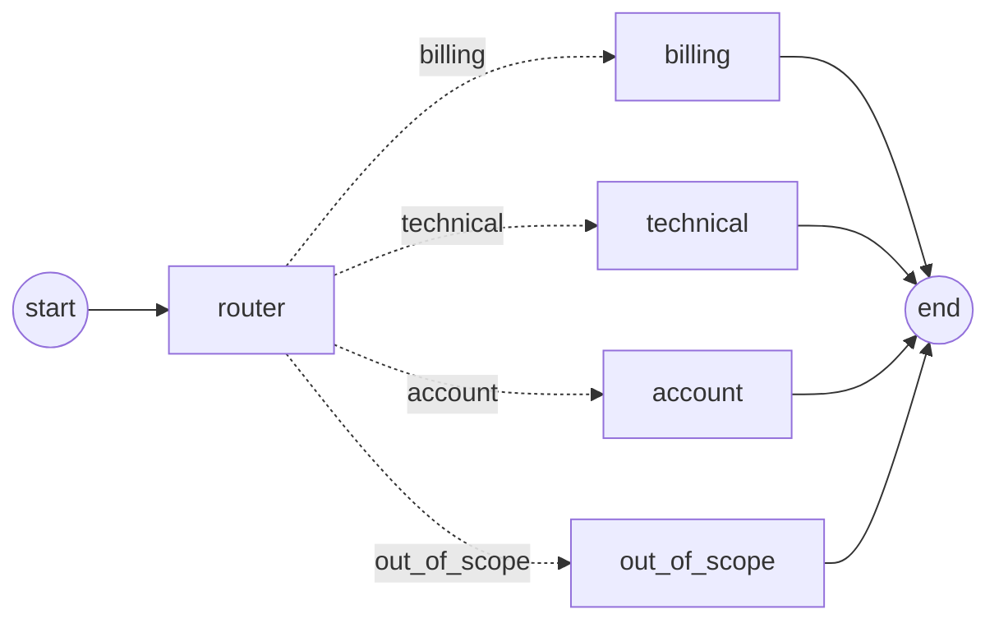

# Pattern 02: Router

A classifier agent reads each input and sends it to **one** specialist agent. Unlike the sequential pipeline, the path through the graph is no longer fixed in code: the model decides it on every run.



Dotted arrows are conditional edges: only one of them is taken per run, depending on the router's decision.

**TL;DR.** On a 30-question customer support benchmark, routing to specialists used **35% fewer input tokens** than a single agent holding all the knowledge, with **equivalent answer quality**. In exchange, it produced **2.1x the output tokens** and took **2.1x the latency**. The router picked an acceptable route 100% of the time and the exact route 99% of the time, but its single miss produced the worst answer in the whole evaluation.

## Use case

A customer support assistant for **Ledgerly**, a fictional invoicing app for freelancers and small businesses.

| Agent | Input | Output | Responsibility |
|-------|-------|--------|----------------|
| `router` | `question` | `route` | Classify the question into one of four routes, using structured output |
| `billing` | `question` | `answer` | Answer using only the billing knowledge base (plans, refunds, payments, VAT, fees) |
| `technical` | `question` | `answer` | Answer using only the technical knowledge base (integrations, import/export, emails, API) |
| `account` | `question` | `answer` | Answer using only the account knowledge base (sign-in, 2FA, roles, deletion) |
| `out_of_scope` | `question` | `answer` | Politely decline questions that are not about using Ledgerly |

Each specialist sees only its own knowledge base (~300 words). The question is wrapped in `<question>` tags in every call.

## The question this pattern tests

Pattern 01 showed that splitting a task across agents costs tokens. The router makes the opposite bet: it adds one extra call, but each specialist gets a much smaller context than a single agent holding all the knowledge. **Can routing make the system cheaper without hurting answer quality?**

The new risk is misrouting. If the router picks the wrong specialist, that specialist answers without the information it needs, and no later step can fix it.

## Design

### State

```python
Route = Literal["billing", "technical", "account", "out_of_scope"]


class RouterState(TypedDict, total=False):
    question: str
    route: Route
    answer: str
    usage: Annotated[list[LLMUsage], operator.add]
```

- `Route` is defined once and reused by the state, the router's Pydantic schema and the graph's routing function, so the set of valid routes lives in a single place.
- All specialists write to the same `answer` field, because only one of them runs per question.

### Router

- **Structured output** with a Pydantic schema (`RouteDecision`) whose `route` field is typed as `Route`, so the decision is validated against the allowed values. A `reasoning` field comes first, so the model reasons before choosing; it is discarded after the decision.
- **`include_raw=True`** returns the raw model message alongside the parsed decision. That is how the router reports its token usage: unlike the judge, the router's tokens are part of the system's cost.
- **`method="json_schema"`**, because forced tool calling is not supported for structured output on the models used.
- **Fails loudly** if the model returns an invalid decision, instead of falling back to a default route that would hide the error and bias router accuracy.
- **Tie-breaking rule for ambiguous questions:** choose the route whose policies are needed to answer. For example, "If I delete my account, do I get a refund?" goes to `billing`, because the answer depends on the refund policy, not on the deletion process.

### Specialists

The three knowledge-based specialists are identical except for their area and knowledge base, so they are built with a **node factory**, `make_specialist(area)`. The factory reads the knowledge base and builds the system prompt once, at import time, and returns a node that remembers them through a closure. `out_of_scope` has no knowledge base and a different prompt, so it is a separate function rather than a special case inside the factory.

This is the abstraction Pattern 01 deliberately avoided: there, three explicit functions were easier to read. Here, the repetition is exact and the factory removes it.

Specialists are told to say so when their knowledge base does not contain the answer, instead of inventing one. That rule decides what happens when a question reaches the wrong specialist.

### Graph

The routing function, `select_route`, only reads `state["route"]`; it never calls a model. The decision is made by the `router` node, and the conditional edge just follows it. The path map lists every possible destination, so LangGraph can validate the graph and draw all branches.

### Baseline

A single agent with all three knowledge bases in one prompt (~940 words of knowledge), and the specialists' answer rules and out-of-scope rule combined, word for word where possible. The only difference between the two systems is the architecture.

## Dataset

30 customer questions (`data/questions.jsonl`), each labeled with:

- `expected_route` and `acceptable_routes`: the correct route, plus alternatives that are reasonable for ambiguous questions.
- `required_facts`: the facts a correct answer must include, taken from the knowledge bases.
- `tags`: `easy`, `informal`, `ambiguous`, `hard-case`, `out-of-scope`.

| Expected route | Cases |
|----------------|------:|
| billing | 10 (2 ambiguous) |
| technical | 9 (1 ambiguous) |
| account | 7 |
| out_of_scope | 4 |

**Ambiguous cases are designed as traps.** In each one, the complete answer exists only in the primary route's knowledge base. Sending the question to the acceptable-but-not-optimal route means the specialist lacks the information it needs, which measures the quality cost of reasonable misrouting.

The knowledge bases (`data/knowledge/*.md`) contain concrete, verifiable facts such as prices, limits, time frames and settings paths, so answers can be checked against them.

## Evaluation

### Setup

| | |
|---|---|
| Systems | `router` (router + one specialist, 2 calls) vs. `baseline` (1 call with all knowledge bases) |
| Worker model | `claude-haiku-5-5`, used by the router, the specialists and the baseline |
| Judge model | `claude-sonnet-5-5` |
| Dataset | 30 questions, 3 runs per question and system, 180 executions in total |

### What is measured

- **Routing accuracy, deterministically.** `route_correct`: the chosen route is in `acceptable_routes`. `route_exact`: it is exactly `expected_route`. Only the router system reports a route, so the baseline has no routing metrics.
- **Answer quality, with an LLM judge** scoring three criteria from 1 to 5:
  - *correctness*: every claim is supported by the knowledge base;
  - *completeness*: the answer includes the required facts, or follows the expected behavior for out-of-scope questions;
  - *concision*: the answer addresses what was asked, without unrequested information.
- **Tokens and end-to-end latency**, per agent.

### Two lessons from building the evaluation

**1. Ground the judge in the full knowledge base, not just the expected answer.** The first version of the judge only saw each question's `required_facts`. It scored a correct answer 2/5 on correctness because the answer mentioned that monthly plans are not refundable, a true policy that simply was not in the required list. A judge validated against a reference that is too narrow confuses "not required" with "false". The fix was to give the judge two separate references: the **full knowledge base** for correctness, and the **required facts** for completeness. True but irrelevant facts are now penalized under concision, where they belong. The problem was caught by reading the judge's reasoning on a single case before scaling up, which is the main reason the judge writes its reasoning before scoring.

**2. Fix shared prompt defects before measuring architectures.** A smoke test showed both systems padding answers with unrequested policies, so concision scored 2–3 for nearly everything and drowned out other differences. The same rule ("Answer only what was asked...") was added to both the specialists' and the baseline's prompts before the full run. Because the change was identical on both sides, it does not bias the comparison.

### Evolving the shared harness

This pattern was the first to need more from the shared harness (`core/harness.py`) than Pattern 01:

- **Systems now return metadata.** The contract changed from `(output, usage)` to `(output, usage, metadata)`, a free-form dict the harness stores and passes to the judge without interpreting it. The router reports `{"route": ...}`; systems with nothing extra return `{}`. Pattern 01's adapters were updated to return `{}`, and its evaluation was re-run to confirm the change was backward compatible.
- **Boolean metrics are reported as rates.** In Python `bool` is a subclass of `int`, so `route_correct` would have been averaged together with the 1–5 scores. The summary now separates grades (non-boolean ints, combined into `avg_score`) from flags (booleans, reported as `*_rate` columns).

### Results

| System | Completeness | Correctness | Concision | Avg score | Score std | Route correct | Route exact | Calls | Input tokens | Output tokens | Latency | Errors |
|--------|-------------:|------------:|----------:|----------:|----------:|--------------:|------------:|------:|-------------:|--------------:|--------:|-------:|
| router | 4.94 | 4.38 | 4.03 | 4.45 | 0.44 | 100% | 99% | 2 | 1,598 | 176 | 2.57 s | 0/90 |
| baseline | **5.00** | **4.40** | **4.13** | **4.51** | 0.42 | – | – | 1 | 2,442 | **83** | **1.23 s** | 0/90 |

Scores and resources are means per run. Raw results: [`results/`](results/).

### Findings

**1. Routing saves input tokens, and pays for it in output tokens and latency.** Each specialist loads one knowledge base instead of three, so the router path used **35% fewer input tokens** (about 65% fewer on out-of-scope questions, whose node loads no knowledge base at all). But the router's reasoning **doubled the output tokens**, and two calls in sequence **doubled the latency**. The routing step alone took 1–2.6 seconds, about half of the total. Whether the trade pays off depends on the relative price of input and output tokens for the model in use; on many models output tokens cost several times more than input tokens, which can cancel the savings.

**2. Answer quality is a tie.** The 0.06 gap in average score is far smaller than the run-to-run spread (~0.43). Correctness is essentially identical. Most easy questions produced near-identical answers from both systems.

**3. The router is almost always right, but its one miss is severe.** It chose an acceptable route in 90 of 90 runs and the exact route in 89. The single miss sent "I downgraded to Free and now my teammates can't log in" to `account` instead of `billing`. The account specialist, which does not know the downgrade policy, answered that it had no information and pointed the customer to support: **1/5 on completeness**, against 5/5 in the other two runs of the same question. That one case explains nearly the whole completeness gap between the systems. Two takeaways:

- For routing, **the severity of a miss matters as much as the miss rate**: here, one routing error turned a 5/5 answer into a 1/5.
- `route_correct` was too lenient for this dataset; `route_exact` is the metric that predicts answer quality.

On the positive side, the specialist did not invent a policy. It admitted it did not know, as its prompt instructs.

**4. Full context has its own failure mode.** In one run of the same downgrade question, the baseline first said that upgrading to "Pro or Team" would restore teammates' access, then contradicted itself by saying only Team would (Pro has a single user). The router's failure is **missing information**; the baseline's is **reasoning across documents**. Holding all the knowledge does not guarantee combining it correctly.

### Comparison with Pattern 01

In Pattern 01, splitting the work cost more and produced worse results. Here, splitting the work **saved** resources along the dimension it targeted (context size), without losing quality, but paid along two others (output and latency). The router is not better or worse in the abstract: it is a tool for when context is the bottleneck, and it pays off most when the routing decision itself is cheap and fast.

### Limitations

- **Small knowledge bases.** Three documents of ~300 words make the context savings modest. The baseline's input grows with the total knowledge, while the router's grows with the largest single document, so the gap should widen with larger knowledge bases. This has not been measured.
- **No prompt caching.** The baseline's system prompt is identical for every question, the ideal case for caching. With caching, its input cost would drop sharply and part of the router's advantage would disappear. Not measured.
- **One model for everything.** The router used the same model as the specialists. A smaller, cheaper model for the routing decision could change the latency and output-token picture.
- **LLM judge without human calibration,** and a single misrouting event, which is enough to illustrate the risk but not to estimate its frequency.

## Files

| File | Contents |
|------|----------|
| `state.py` | `Route` and `RouterState` |
| `agents.py` | Router with structured output, specialist factory, `out_of_scope` node and their prompts |
| `graph.py` | LangGraph wiring with conditional edges, `run_router()` entry point |
| `baseline.py` | Single-agent baseline with all knowledge bases in one prompt |
| `judge.py` | LLM judge grounded in the knowledge base, plus deterministic routing accuracy |
| `run.py` | Evaluation entry point: runs both systems, judges them, prints the summary table |
| `data/questions.jsonl` | Evaluation dataset (30 questions) |
| `data/knowledge/` | One knowledge base per specialist |
| `results/` | Raw results of the evaluation reported above |

## Running

Requires `ANTHROPIC_API_KEY`, `WORKER_MODEL` and `JUDGE_MODEL` in `.env`.

```bash
# Run each system on a sample question
uv run python -m patterns.p02_router.graph
uv run python -m patterns.p02_router.baseline

# Judge one case end to end
uv run python -m patterns.p02_router.judge

# Full evaluation (30 questions x 3 runs x 2 systems = 180 executions)
uv run python -m patterns.p02_router.run

# Quick smoke test
uv run python -m patterns.p02_router.run --limit 3 --runs 1

# Recompute the table from saved results, without calling any model
uv run python -m patterns.p02_router.run --from-file patterns/p02_router/results/p02_router_20261024_202218.jsonl
```

## Bonus: an LLM router vs. a decision model

> Coming next. Finding 1 shows that the routing step accounts for about half of the latency and most of the extra output tokens. This bonus replaces the LLM router with Jev, a structured decision model from TypeSafe that returns a choice with probabilities instead of generating text, and compares the two on routing accuracy, routing latency, agreement, and whether Jev's confidence flags its own mistakes.