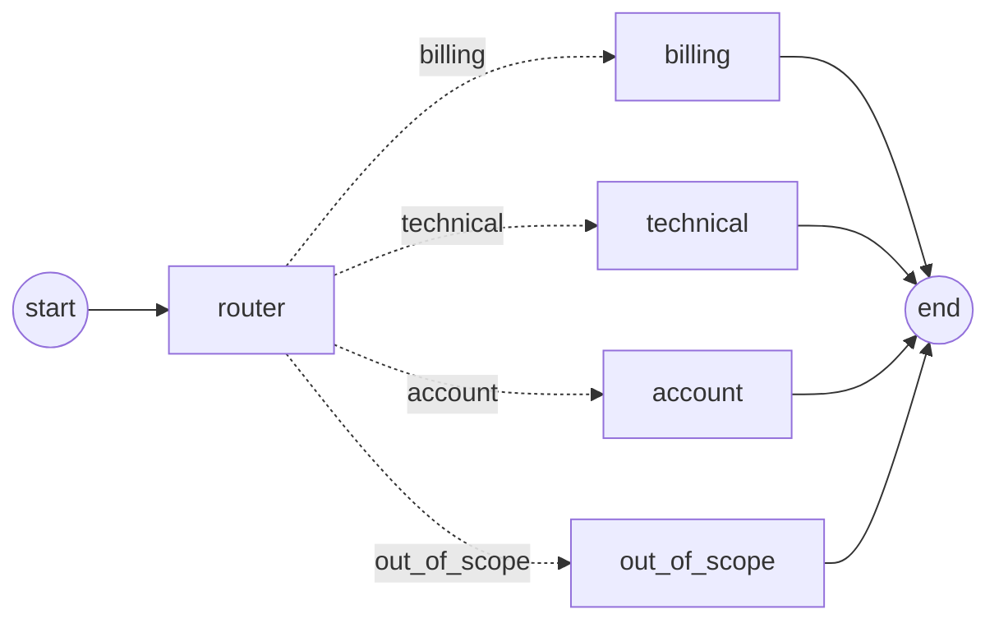

# Pattern 02: Router

A classifier agent reads each input and sends it to **one** specialist agent. Unlike the sequential pipeline, the path through the graph is no longer fixed in code: the model decides it on every run.

> **Status:** work in progress. The router graph is implemented; the baseline and evaluation are next.



Dotted arrows are conditional edges: only one of them is taken per run, depending on the router's decision.

## Use case

A customer support assistant for **Ledgerly**, a fictional invoicing app for freelancers and small businesses.

| Agent | Input | Output | Responsibility |
|-------|-------|--------|----------------|
| `router` | `question` | `route` | Classify the question into one of four routes, using structured output |
| `billing` | `question` | `answer` | Answer using only the billing knowledge base (plans, refunds, payments, VAT, fees) |
| `technical` | `question` | `answer` | Answer using only the technical knowledge base (integrations, import/export, emails, API) |
| `account` | `question` | `answer` | Answer using only the account knowledge base (sign-in, 2FA, roles, deletion) |
| `out_of_scope` | `question` | `answer` | Politely decline questions that are not about using Ledgerly |

Each specialist sees only its own knowledge base (~300 words). The question is wrapped in `<question>` tags in every call.

## The question this pattern tests

Pattern 01 showed that splitting a task across agents costs tokens. The router makes the opposite bet: it adds one extra call, but each specialist gets a much smaller context than a single agent holding all the knowledge. **Can routing make the system cheaper without hurting answer quality?**

The new risk is misrouting. If the router picks the wrong specialist, that specialist answers without the information it needs, and no later step can fix it.

## Design

### State

```python
Route = Literal["billing", "technical", "account", "out_of_scope"]


class RouterState(TypedDict, total=False):
    question: str
    route: Route
    answer: str
    usage: Annotated[list[LLMUsage], operator.add]
```

- `Route` is defined once and reused by the state, the router's Pydantic schema and the graph's routing function, so the set of valid routes lives in a single place.
- All specialists write to the same `answer` field, because only one of them runs per question.

### Router

- **Structured output** with a Pydantic schema (`RouteDecision`) whose `route` field is typed as `Route`, so the decision is validated against the allowed values. A `reasoning` field comes first, so the model reasons before choosing; it is discarded after the decision.
- **`include_raw=True`** returns the raw model message alongside the parsed decision. That is how the router reports its token usage: unlike the judge, the router's tokens are part of the system's cost.
- **`method="json_schema"`**, because forced tool calling is not supported for structured output on the models used.
- **Fails loudly** if the model returns an invalid decision, instead of falling back to a default route that would hide the error and bias router accuracy.
- **Tie-breaking rule for ambiguous questions:** choose the route whose policies are needed to answer. For example, "If I delete my account, do I get a refund?" goes to `billing`, because the answer depends on the refund policy, not on the deletion process.

### Specialists

The three knowledge-based specialists are identical except for their area and knowledge base, so they are built with a **node factory**, `make_specialist(area)`. The factory reads the knowledge base and builds the system prompt once, at import time, and returns a node that remembers them through a closure. `out_of_scope` has no knowledge base and a different prompt, so it is a separate function rather than a special case inside the factory.

This is the abstraction Pattern 01 deliberately avoided: there, three explicit functions were easier to read. Here, the repetition is exact and the factory removes it.

### Graph

The routing function, `select_route`, only reads `state["route"]`; it never calls a model. The decision is made by the `router` node, and the conditional edge just follows it. The path map lists every possible destination, so LangGraph can validate the graph and draw all branches.

## Dataset

30 customer questions (`data/questions.jsonl`), each labeled with:

- `expected_route` and `acceptable_routes`: the correct route, plus alternatives that are reasonable for ambiguous questions.
- `required_facts`: the facts a correct answer must include, taken from the knowledge bases.
- `tags`: `easy`, `informal`, `ambiguous`, `hard-case`, `out-of-scope`.

| Expected route | Cases |
|----------------|------:|
| billing | 10 (2 ambiguous) |
| technical | 9 (1 ambiguous) |
| account | 7 |
| out_of_scope | 4 |

**Ambiguous cases are designed as traps.** In each one, the complete answer exists only in the primary route's knowledge base. Sending the question to the acceptable-but-not-optimal route means the specialist lacks the information it needs, which measures the quality cost of reasonable misrouting.

The knowledge bases (`data/knowledge/*.md`, ~940 words in total) contain concrete, verifiable facts such as prices, limits, time frames and settings paths, so answers can be checked against them.

## Files

| File | Contents |
|------|----------|
| `state.py` | `Route` and `RouterState` |
| `agents.py` | Router with structured output, specialist factory, `out_of_scope` node and their prompts |
| `graph.py` | LangGraph wiring with conditional edges, `run_router()` entry point |
| `data/questions.jsonl` | Evaluation dataset (30 questions) |
| `data/knowledge/` | One knowledge base per specialist |

## Running

Requires `ANTHROPIC_API_KEY` and `WORKER_MODEL` in `.env`.

```bash
uv run python -m patterns.p02_router.agents   # test the router and one specialist
uv run python -m patterns.p02_router.graph    # run the full graph on a sample question
```

## Early observations

From individual runs during development, not yet a measured result:

- **The router has a fixed cost.** Its prompt is about 300 words, but each call used ~735–745 input tokens, because structured output adds the JSON schema to the request.
- **One question through the router path used ~1,690 input tokens** (router ~735 plus specialist ~960). That is the number the single-agent baseline has to beat.
- **Specialists tend to add information that was not asked for**, such as where to find billing history in an answer about plan price. If the evaluation confirms it, this is a prompt issue rather than an architectural one.

## Next steps

- Single-agent baseline with all three knowledge bases in one prompt.
- Evaluation: router accuracy (deterministic, against `expected_route` and `acceptable_routes`), answer quality with an LLM judge using `required_facts`, tokens and latency.
- Extend the shared harness so systems can report extra outputs, such as the chosen route.